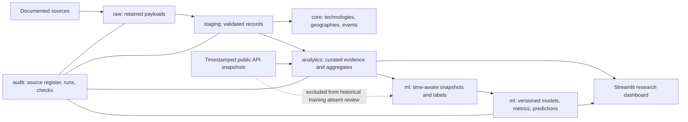

# Architecture and canonical contract

The SQL contract is `migrations/001_canonical_schema.sql`. The old public tables in `docs/schema_diagram.md` and the six-table loader contract are historical contracts, not canonical schemas. No destructive conversion is performed. Old evidence stays available for comparison and must be labeled superseded.

`raw` keeps source payloads/checksums, `staging` holds validated candidate rows, `core` contains canonical entities and community facts, `analytics` stores sourced observations and aggregates, `ml` stores snapshots/labels/runs/results, and `audit` records source and run lineage. `data_lineage.json` is the machine-readable audit inventory.

## Data dictionary summary

| Schema | Main tables | Meaning |
|---|---|---|
| audit | `data_sources`, `source_documents`, `ingestion_runs`, `ingestion_errors`, `data_quality_checks`, `schema_migrations` | Source terms, retrieval, run and validation record |
| raw / staging | `source_records`, `validation_records` | Retained source payload and pre-curation validation |
| core | `geographies`, `technologies`, `technology_aliases`, `technology_categories`, `technology_category_memberships`, `community_questions`, `company_profiles` | Canonical entity and event layer |
| analytics | `community_monthly_metrics`, `stack_exchange_tag_observations`, `github_repository_observations`, `package_registry_observations`, `technology_release_events`, `live_technology_observations`, survey/skills/jobs/ICT/training/company evidence tables | Sourced, timestamped measures; source class and geography are explicit |
| ml | `feature_snapshots`, `feature_values`, `label_definitions`, `technology_labels`, model registry/metrics/predictions/explanations/baselines | Reproducible time-aware modeling and output |

Observation `observed_at` describes source-event or measurement time; `collected_at` records retrieval time. `NULL` and missingness flags mean unavailable; zero is used only when a source explicitly observed zero. Company profiles do not imply adoption. Explanations describe associations, not causation.
