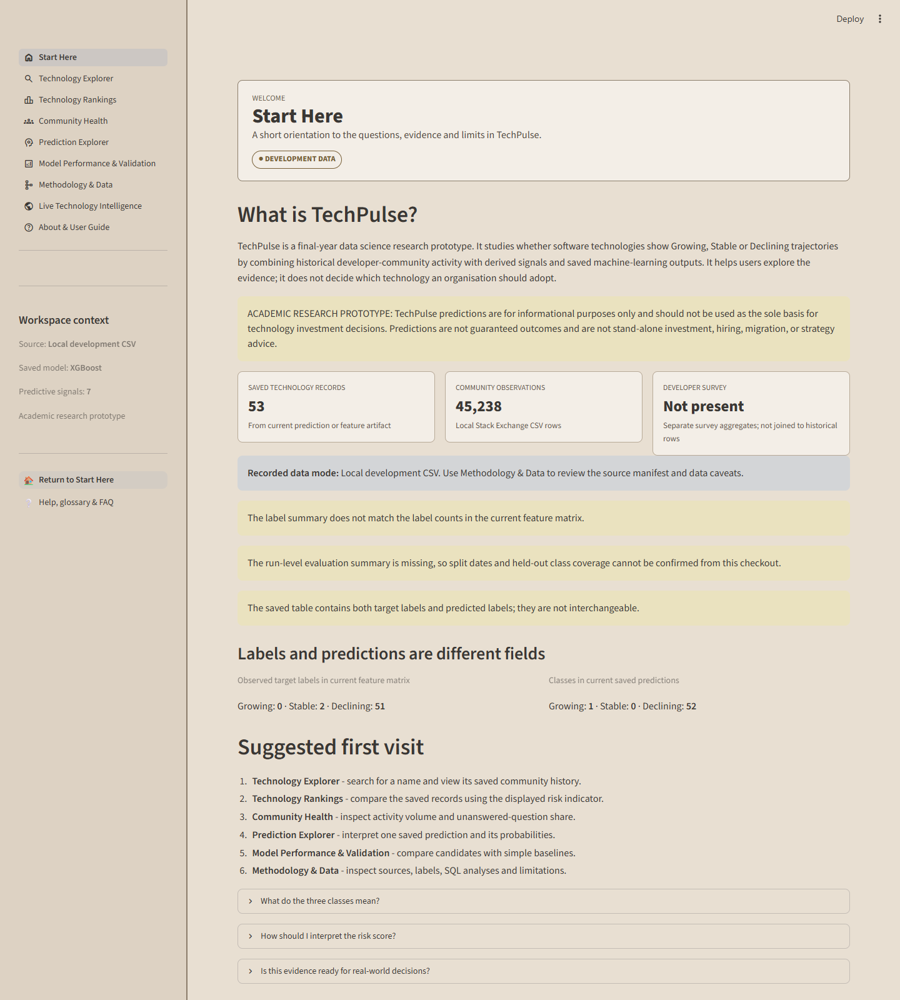
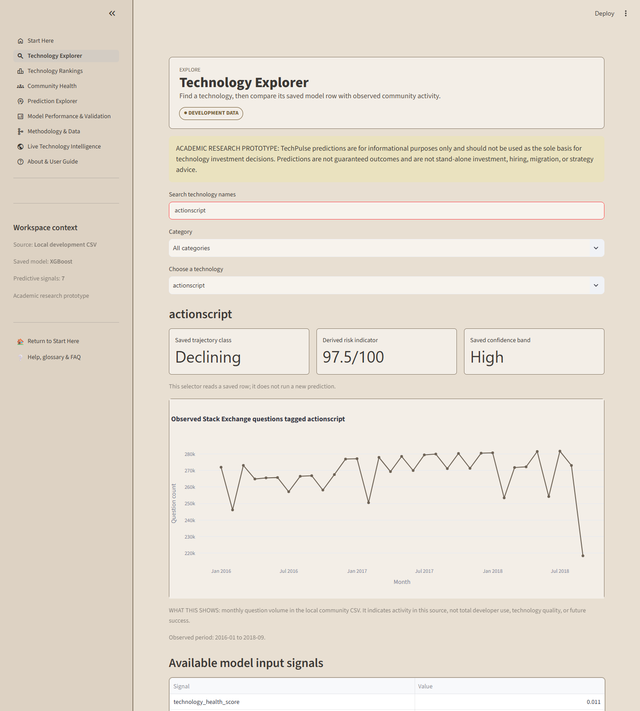
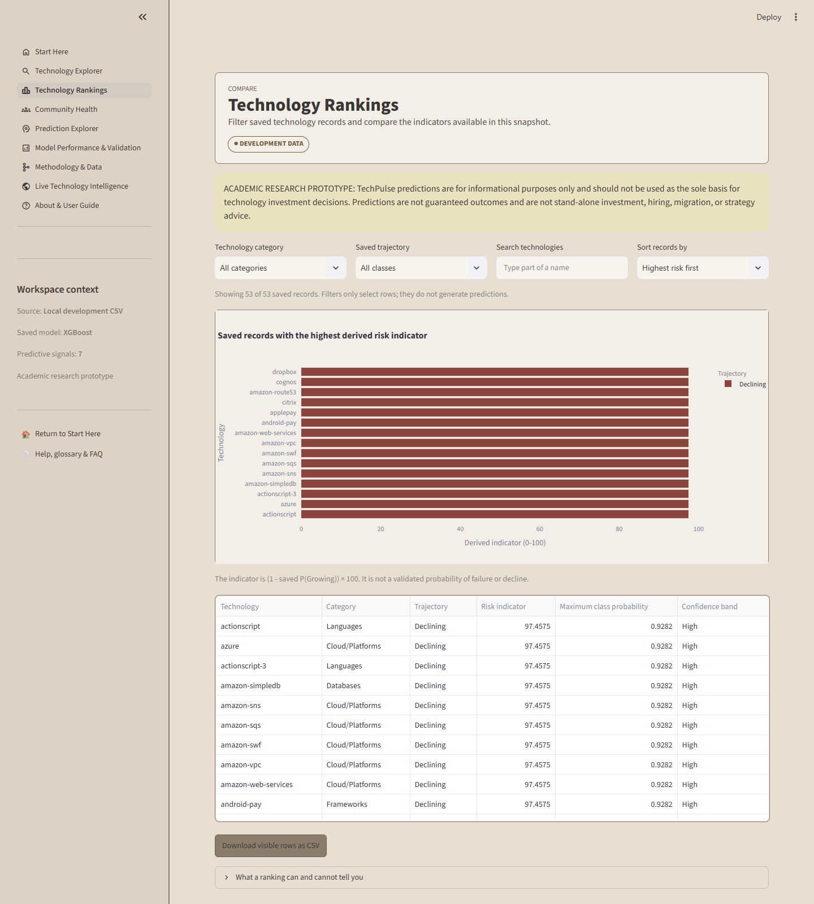
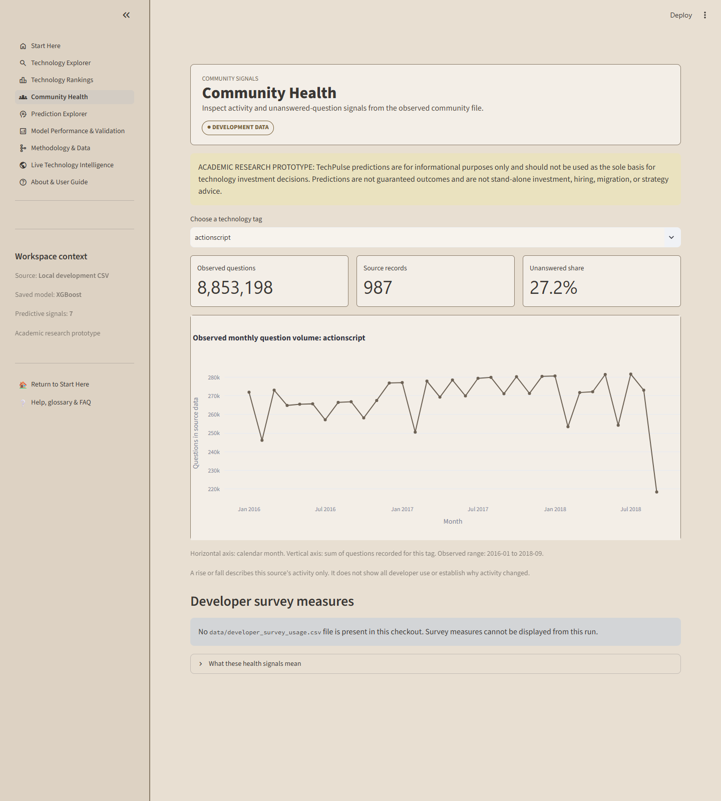
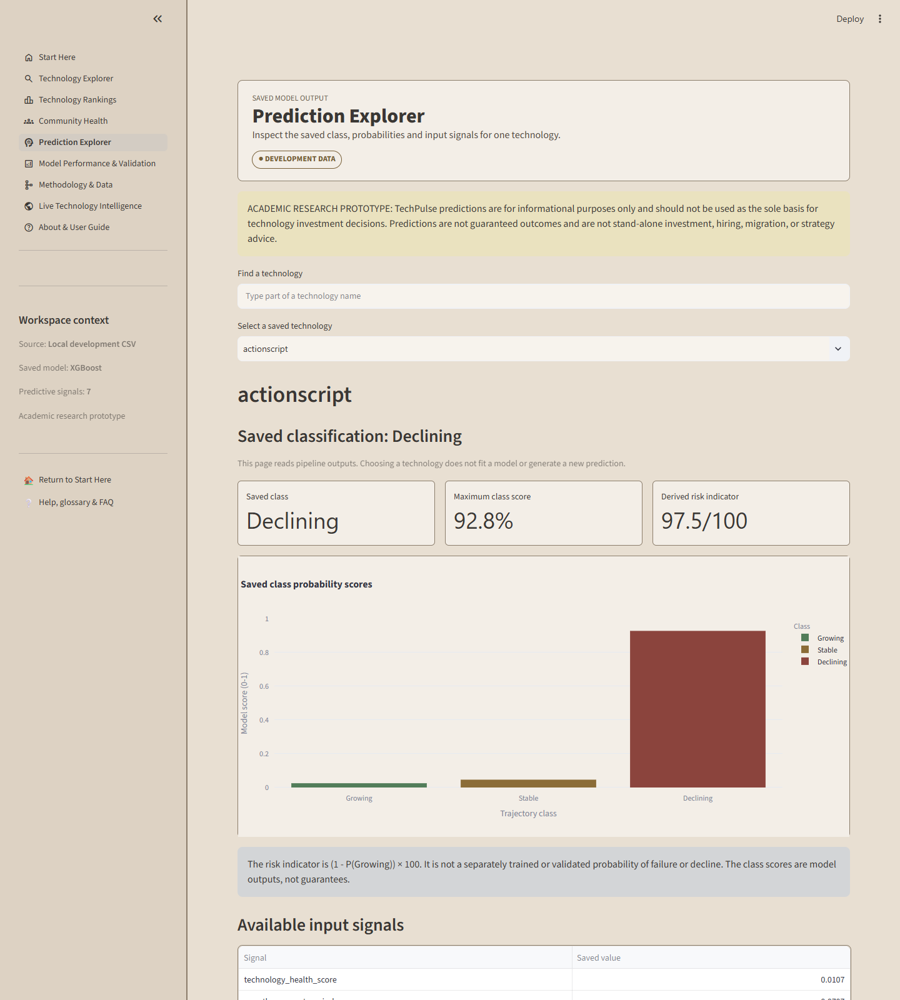
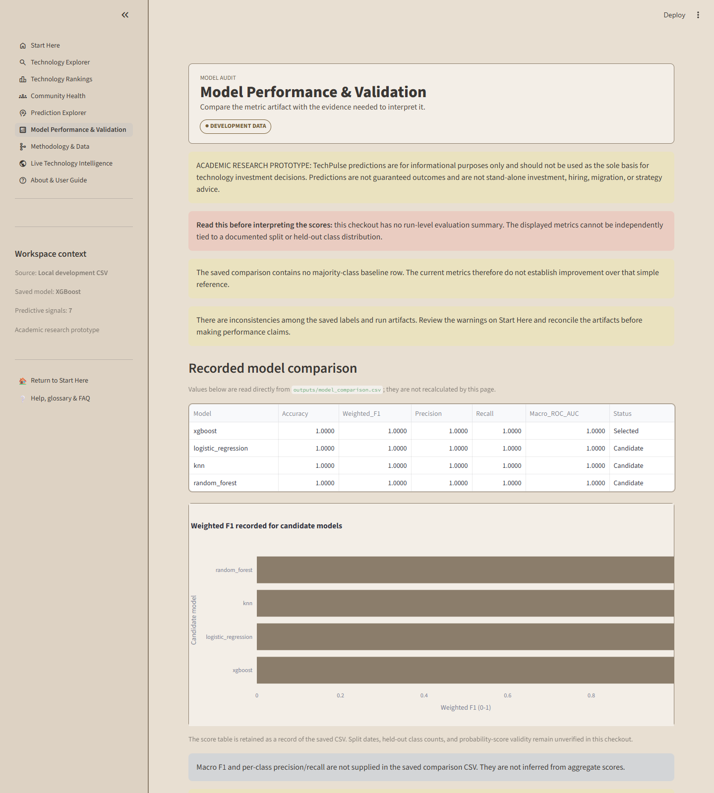
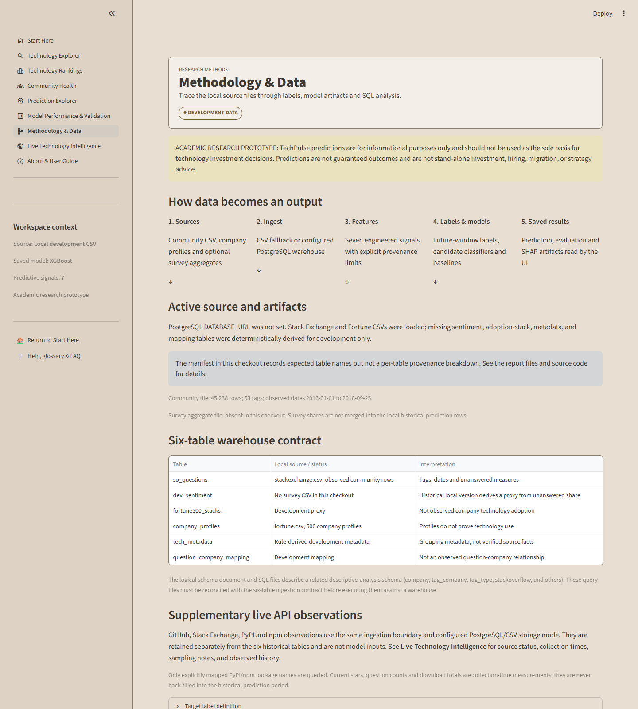
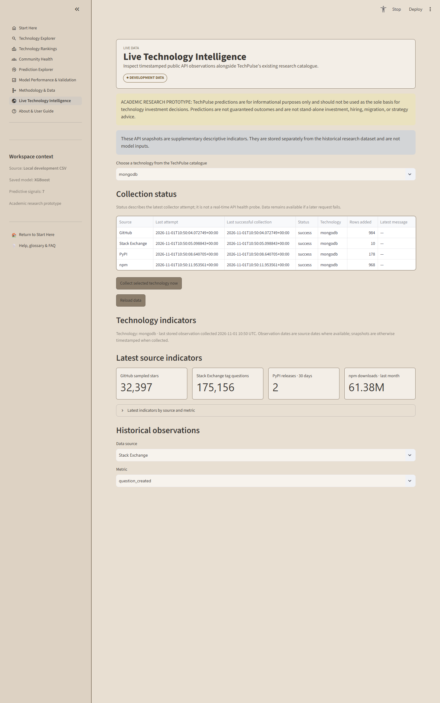
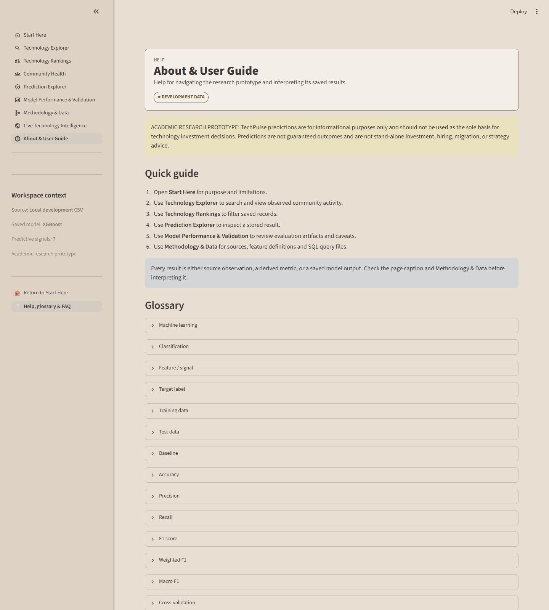

# TechPulse User Manual

**Assessing Developer Technology Trajectories with Community Signals and Transparent Validation**  
KCA University · BSc Data Science · 2026  
Version date: 1 November 2026

> This guide describes the current OneDrive project checkout. It separates observed source data, development proxies, derived metrics and saved model outputs. The screenshots were captured from the redesigned application running locally.

## Contents

1. Introduction
2. System requirements
3. Installation and data mode
4. Launching TechPulse
5. First-time orientation
6. Using the nine application pages
7. Understanding trajectory labels
8. Understanding saved predictions
9. Understanding model performance
10. Understanding the data
11. Troubleshooting
12. Glossary
13. Limitations and responsible use
14. Frequently asked questions

## Chapter 1: Introduction

TechPulse is a final-year data-science research prototype. It studies whether software technology observations can be labelled Growing, Stable or Declining using historical developer-community activity and engineered signals. Its pages help a student, lecturer or researcher inspect the data and saved model outputs.

Use the application to explore the available records, inspect community activity, understand how the pipeline defines labels, and review model-evaluation artifacts. It does not make a new prediction when a user selects a technology. It is not a technology-quality rating or a recommendation for hiring, investment, migration or procurement.



## Chapter 2: System requirements

- Windows 10/11, macOS, or a supported Linux distribution.
- Python 3.10 or newer (the repository badge describes Python 3.10+).
- A current Chrome, Edge, Firefox or Safari browser.
- Approximately 4 GB RAM for the dashboard and existing local artifacts; more memory may be needed to rerun model training.
- Internet access is not required to open local CSV artifacts. It is needed to install dependencies or download public survey source files.
- PostgreSQL is optional for local CSV mode. A PostgreSQL server with the six required warehouse tables is needed only when using the database ingestion route.

The repository lists its dependencies in `requirements.txt`. Installation may take several minutes because machine-learning packages are included.

## Chapter 3: Installation and data mode

### Windows PowerShell

Open PowerShell, change to the folder that contains `README.md`, and run:

```powershell
cd C:\path\to\TechPulse
python -m venv .venv
.\.venv\Scripts\Activate.ps1
python -m pip install --upgrade pip
python -m pip install -r requirements.txt
```

The first line enters the repository folder. `venv` creates an isolated Python environment so project libraries do not mix with unrelated Python projects. The activation command selects that environment for the current terminal. The final commands update the package installer and install the project dependencies. If PowerShell blocks activation, follow your institution's policy; you can run `.\.venv\Scripts\python.exe -m pip install -r requirements.txt` and `.\.venv\Scripts\python.exe -m streamlit run dashboard/app.py` without activating.

### Linux or macOS

```bash
cd /path/to/TechPulse
python3 -m venv .venv
source .venv/bin/activate
python -m pip install --upgrade pip
python -m pip install -r requirements.txt
```

### CSV fallback or PostgreSQL

With no `DATABASE_URL` configured, the pipeline uses local CSV mode. The application reads the saved outputs and can be opened without configuring PostgreSQL. If a `DATABASE_URL` is set, the pipeline attempts PostgreSQL and reports a connection or schema error rather than silently switching to CSV.

To use PostgreSQL, ask the project maintainer for the approved warehouse connection and schema. Store credentials in a private local environment configuration; never paste them into source code, screenshots, reports or Git. The ingestion code expects `so_questions`, `dev_sentiment`, `fortune500_stacks`, `company_profiles`, `tech_metadata`, and `question_company_mapping`.

The current OneDrive checkout does not include `data/developer_survey_usage.csv`. The pipeline may derive demo sentiment from unanswered-question rates in local mode; that value is a proxy and is not a public developer-survey measure. Do not describe it as observed survey sentiment.

### Refreshing pipeline artifacts

Run `python pipeline/run_pipeline.py` only when you intend to regenerate the model and outputs. It writes into `outputs/` and `models/`; preserve prior artifacts first if you need them. The current feature table has 53 rows, while the label summary and saved model metrics do not describe a matching current run. The application flags this. Do not use a rerun as a way to erase the warning without verifying the new artifacts.

### Configuring and scheduling live observations

The dashboard never calls the external APIs automatically. Copy `.env.example` to a private `.env` file if you need credentials or want to change timeouts, sampling limits, the Stack Exchange site or schedule settings. `GITHUB_TOKEN` and `STACKEXCHANGE_KEY` are optional; leave them blank for anonymous public API access within the smaller anonymous quotas. Never add actual keys to `.env.example` or commit `.env`.

To query one saved catalogue technology from PowerShell, run `python scripts/collect_live_data.py --technology mongodb`. It collects in a separate process when started from the dashboard. The scheduled mode runs immediately and then repeats each day: `python scripts/schedule_live_data.py`. To verify one batch and exit, run `python scripts/schedule_live_data.py --once`. Keep the long-running scheduler under a service manager or Windows Task Scheduler; stop it with Ctrl+C when running interactively. The default batch is limited to five technologies and two pages per paginated endpoint.

Without PostgreSQL observations are stored in the ignored local file `outputs/live_data/live_observations.csv`. With `DATABASE_URL`, they are stored in the additive `techpulse_live_observations` table created on first write. The historical six-table CSV/PostgreSQL source contract does not change.

## Chapter 4: Launching TechPulse

From the repository root, with the project environment active:

```bash
python -m streamlit run dashboard/app.py
```

On Windows PowerShell, the same command works. Successful startup prints a local address such as `http://localhost:8501`. Open that address in your browser. Keep the terminal open while using TechPulse. To stop the server, focus the terminal and press `Ctrl+C`.

If port 8501 is busy, run `python -m streamlit run dashboard/app.py --server.port 8502` and open `http://localhost:8502`. For other errors, see Chapter 11.

## Chapter 5: First-time orientation

The navigation is in the left sidebar. It contains the nine research-journey pages. The main panel shows the selected page, filters, charts and explanations. The sidebar's workspace context displays the source mode and selected saved model name. A Development Data badge and research disclaimer appear on every page.


Start at **Start Here**. Review the artifact warnings before looking at scores. Use the sidebar to move to a page; use each search field or selector only to filter saved records. Expand the on-page help sections for definitions and interpretation limits. The global persistent sidebar links return to Start Here and Help.

## Chapter 6: Using the nine application pages

### 6.1 Start Here

**Purpose:** Explain the research prototype and show the active data mode.  
**Use it:** Review the record counts, source mode and visible artifact-consistency warnings. Read the class explanations and suggested page sequence.  
**Interpretation:** The target labels in the feature matrix and predicted classes in the saved prediction file are separate fields. The page shows both separately when present.  
**Common mistake:** Treating the class counts as validation performance. A class distribution is not a test score.  
**Limit:** The current label summary does not match the feature matrix; the evaluation summary file is absent.

### 6.2 Technology Explorer



**Purpose:** Find a saved technology row and compare it with available observed community history.  
**Use it:** Type a name into **Search technology names**, press Enter, choose **Category** if desired, then select **Choose a technology**. The app displays the saved class and available signals. A historical chart appears only when an exact matching tag exists.  
**Read the chart:** Horizontal axis is month; vertical axis is recorded questions in the local community file. A rising line means higher volume in this source over that period. It does not establish the cause of the change or total technology usage.  
**Common mistake:** Assuming a missing chart means zero activity. Missing history is shown as unavailable.

### 6.3 Technology Rankings



**Purpose:** Filter and compare saved prediction rows.  
**Use it:** Choose **Technology category**, **Saved trajectory**, enter **Search technologies**, and select **Sort records by**. Use **Download visible rows as CSV** to export the filtered table.  
**Interpretation:** When all class probabilities exist, the chart sorts `(1 - P(Growing)) × 100`. This is a derived indicator.  
**Limit:** The ranking is not a popularity or quality ranking, and filters do not make a fresh model prediction.

### 6.4 Community Health



**Purpose:** Inspect observed community question volume and unanswered share.  
**Use it:** Select a **technology tag**. Read total questions, source records and unanswered share; inspect the monthly chart.  
**Read the chart:** Month is on the horizontal axis and source question count is on the vertical axis. Unanswered share is unanswered questions divided by question count when both fields are available.  
**Limit:** This is one community platform, not all developers. Do not infer technology quality or causation. Survey aggregates, if present, appear separately and may not align with historical records.

### 6.5 Prediction Explorer



**Purpose:** Explain one existing prediction row.  
**Use it:** Search a technology and select it. Review **Saved classification**, the probability chart, **Maximum class score**, **Derived risk indicator**, and available input signals. A saved local SHAP explanation appears only when a matching artifact entry exists.  
**Interpretation:** Confidence is the highest saved class score. SHAP attributes a model output across its input features; it is not causal evidence.  
**Limit:** Selecting a name only retrieves saved output. The application has no new-input prediction form.

### 6.6 Model Performance & Validation



**Purpose:** Display recorded metrics and expose whether they can be audited.  
**Use it:** Read the warnings first, then compare candidate rows and expand explanations for Accuracy, Precision, Recall, Weighted F1, Macro F1, baselines, and split methodology.  
**Current snapshot:** The CSV records Accuracy, Weighted F1, Precision, Recall and Macro ROC-AUC of 1.0000 for four candidate models. The current feature matrix has 53 rows, while `labelling_summary.json` describes 36 rows (12 per class), and the run-level evaluation summary is absent. The comparison CSV contains no baseline row. The recorded values are therefore not independently attributable to the current feature table and should not be reported as validated performance.  
**Limit:** Macro F1 and per-class precision/recall are absent. The training source uses a stratified random 80/20 split, not a time-forward split.

### 6.7 Methodology & Data



**Purpose:** Trace the source-to-output workflow and inspect the SQL analyses.  
**Use it:** Review the active manifest, six-table contract, label rule, feature names and validation limits. Expand a numbered SQL analysis to see its purpose and actual repository query.  
**Limit:** Existing SQL files refer to a related descriptive schema; reconcile table names with the six-table ingestion contract before running in a warehouse.

### 6.8 Live Technology Intelligence



**Purpose:** Inspect supplementary, timestamped snapshots from public technology APIs.  
**Use it:** Select a technology from the existing saved catalogue. Review per-source status, last attempt, last successful collection and any error. **Collect selected technology now** launches a separate process; use **Reload data** to read its results. Choose a source and metric to chart the available history.  
**Sources:** GitHub repository search metadata is a capped sample; Stack Exchange uses the chosen tag and a capped recent-question sample; PyPI and npm data are retrieved only for explicit mappings in `data/live_package_map.json`. npm provides a last-month package download count. The official PyPI JSON API's deprecated downloads field is ignored.  
**Interpretation:** Observation timestamps refer to original event dates when provided by the source; otherwise they record the time the snapshot was collected. Collection timestamps record when TechPulse retrieved them. Missing dates are not imputed as zero.  
**Limit:** Stars, question volume and package downloads are not enterprise adoption or actual production usage. Live observations are not joined to historical features, labels, training, predictions or evaluation.

### 6.9 About & User Guide



**Purpose:** Provide persistent help and plain-language definitions.  
**Use it:** Expand a glossary term or FAQ. Download a guide when the document buttons appear. Use the sidebar link to return to Start Here.  
**Limit:** A glossary definition does not make an unverified score valid; consult the validation page and source caveats.

## Chapter 7: Understanding technology classifications

The source implementation compares a future-window average of monthly question volume with a recent activity average. A ratio of 1.20 or more is labelled Growing. A ratio of 0.80 or less is labelled Declining. Ratios between the thresholds are Stable. The target fields `future_volume`, `future_avg_monthly_volume`, `recent_avg_monthly_volume` and `future_growth_ratio` are not valid model inputs because they define or reveal the future outcome.

In the current checkout, `data/feature_matrix.csv` has 53 rows: 51 target labels are Declining, 2 are Stable, and 0 are Growing. The saved `labelling_summary.json` instead describes 12 rows per class (36 total). This mismatch is shown in the app and requires reconciliation.

## Chapter 8: Understanding predictions

The Prediction Explorer selects a technology from `outputs/technology_predictions.csv` when available. Class probabilities are model outputs; the highest probability ordinarily determines the saved predicted class. Confidence is the maximum class score. Unless the model has been calibrated and validated, these numbers are not guaranteed probabilities of correctness.

Risk uses `Risk indicator = (1 - P(Growing)) × 100`. For example, if `P(Growing) = 0.0254`, the indicator is approximately 97.5/100. The score means the complement of the saved Growing score, not a separately validated chance of failure. The UI reads existing rows and does not infer for a new user-entered technology.

## Chapter 9: Understanding model performance

- **Accuracy:** fraction of test rows predicted correctly. It can hide poor minority-class performance.
- **Precision:** among predictions for one class, the fraction correct.
- **Recall:** among true examples of one class, the fraction identified.
- **F1:** combines precision and recall.
- **Weighted F1:** averages class F1 values weighted by class support; common classes dominate.
- **Macro F1:** averages class F1 equally; it is more sensitive to rare classes.
- **Confusion matrix:** counts correct and incorrect class assignments.
- **Baseline:** a simple reference such as always predicting the most common training class. A complex model should be compared with it.

The current comparison CSV reports four perfect candidate scores, but the run-level evaluation summary is absent, its split cannot be joined to the current 53-row feature table, and no baseline row appears in that CSV. Macro F1 and per-class precision/recall are also missing. Do not interpret 1.000 values as proof of reliable classification. Regenerate artifacts in a controlled run and reconcile labels, test support, and baseline metrics before making a performance claim.

## Chapter 10: Understanding the data

The ingestion contract names six tables:

| Table | Role | Local-mode status |
|---|---|---|
| `so_questions` | Community questions, tags, dates and unanswered measures | Mapped from `data/stackexchange.csv` (45,238 rows; dates 2016-01-01 to 2018-09-25 in the current file). |
| `dev_sentiment` | Survey-derived technology-year data | No survey aggregate CSV is present in this checkout; local fallback can derive a proxy from unanswered share. |
| `fortune500_stacks` | Technology-to-company adoption relation | Deterministic development proxy, not observed company use. |
| `company_profiles` | Company profile and sector information | `data/fortune.csv` (500 profiles); profile presence is not proof of technology use. |
| `tech_metadata` | Technology names and categories | Rule-derived development metadata in local fallback. |
| `question_company_mapping` | Question-to-company relationship | Development mapping, not an observed link in local mode. |

Other files include `data/ev311.csv` (a civic 311 service-request table, not used in the predictive pipeline) and an empty `data/files.csv`. The feature matrix and prediction artifact are derived files, not raw sources. `data/developer_survey_usage.csv` is absent in this checkout. The acquisition script mentioned in other project materials is also absent from this Git checkout.

The SQL files use descriptive tables such as `stackoverflow`, `company`, `tag_company`, and `tag_type`. This schema is not identical to the current six-table ingestion contract. Survey respondents are self-selected; company adoption proxies are not enterprise evidence; feature values are derived, not direct measurements.

## Chapter 11: Troubleshooting

| Issue | What to do |
|---|---|
| Application does not start | Activate the intended virtual environment; reinstall `requirements.txt`; check the terminal's first error. |
| Missing dependency | Run `python -m pip install -r requirements.txt` using the same Python used to launch Streamlit. |
| Database connection error | Check `DATABASE_URL`, network access, table names and credentials privately. A configured failing database does not silently use CSV. |
| Empty chart | Check whether that technology has dated matching rows; the app omits missing history instead of plotting zero. |
| Missing prediction | Check that `outputs/technology_predictions.csv` exists and contains the technology. Run the pipeline only after preserving outputs. |
| Invalid or inconsistent data | Inspect `outputs/data_sources.json`, `outputs/data_quality_report.json` if present, label counts and run summary. |
| Port already in use | Add `--server.port 8502` and open `http://localhost:8502`. |
| Wrong Python environment | Run `python -c "import streamlit; print(streamlit.__version__)"` and compare the Python executable with the active environment. |

## Chapter 12: Glossary

**Machine learning:** fitting patterns from examples to make classifications. **Classification:** assigning one of several categories. **Feature:** a model input. **Target variable:** the label the model is trained to predict. **Training data:** observations used to fit model parameters. **Testing data:** held-out observations used for evaluation. **Baseline:** a simple reference model. **Accuracy:** total fraction correct. **Precision:** correctness among predicted positives for a class. **Recall:** coverage among actual examples for a class. **F1-score:** harmonic balance of precision and recall. **Weighted F1:** class F1 weighted by each class's support. **Cross-validation:** repeated internal splits for model selection. **Feature importance:** a model-dependent description of input use. **SHAP:** additive attribution values for a fitted model output. **PostgreSQL:** relational database software. **Data provenance:** origin and transformation history. **Data leakage:** information from outside the permitted prediction time influencing a model. **Prediction probability:** model score for a class, not automatically calibrated or guaranteed.

## Chapter 13: Limitations and responsible use

TechPulse is an academic research prototype. The local mode contains derived proxies, survey aggregate data is absent from this checkout, the community history covers 2016-2018, current artifacts disagree on class counts, the saved metric run is not matched to the current feature file, and no current baseline row is in the metrics CSV. The training source uses a stratified random split, so temporal generalisation has not been established. The app retrieves saved output; it does not support on-demand inference.

Use the system to demonstrate software and inspect research questions. Do not use it as the sole basis for procurement, migration, hiring, investment or other high-impact decisions. Any future empirical claim requires verified source provenance, temporally appropriate data, reconciled artifacts, representative class support, and transparent per-class comparison against baselines.

## Chapter 14: Frequently asked questions

**Does the app make a prediction for a new technology?** No. It reads saved rows.  
**Does opening Live Technology Intelligence query external APIs?** No. Use its explicit background collection button or the independent daily scheduler.  
**Are live API observations used by the model?** No. They are stored separately until a separate temporal and measurement validation establishes suitability.  
**Does the official PyPI JSON endpoint provide package downloads?** Its deprecated downloads field is always unusable; the dashboard does not report it.  
**Why does the same technology have a target label and predicted class?** The target is derived from observed future activity in the labeled dataset; the prediction is the model output. They must not be treated as interchangeable.  
**Does a risk value of 97 mean a 97% chance of decline?** No. It is a complement of the Growing class score.  
**Why is there a Development Data badge?** The local CSV mode includes development-derived tables and is not research-grade evidence.  
**Why does the metrics page warn about perfect scores?** Run metadata is missing, the metrics do not align with current labels, and the current comparison has no baseline row.  
**Can I run the twelve queries now?** Only after the target PostgreSQL schema and data lineage are reconciled with the SQL assumptions.
